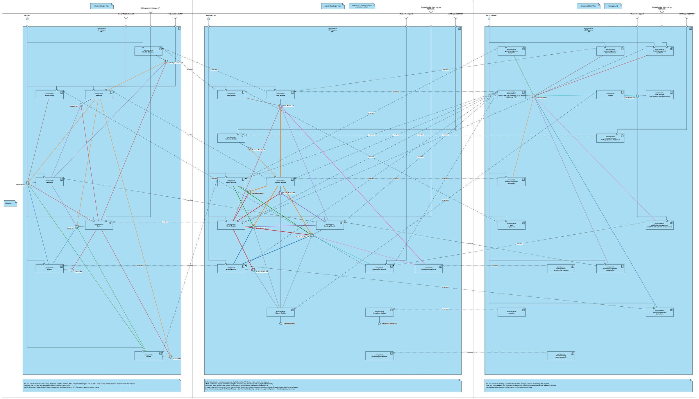
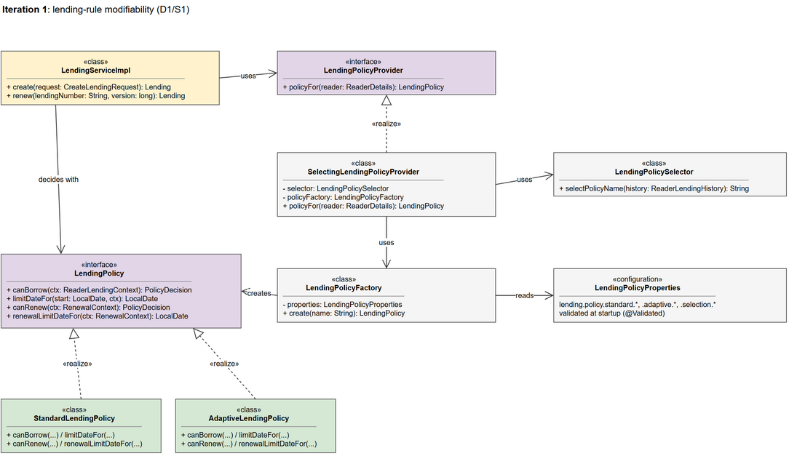
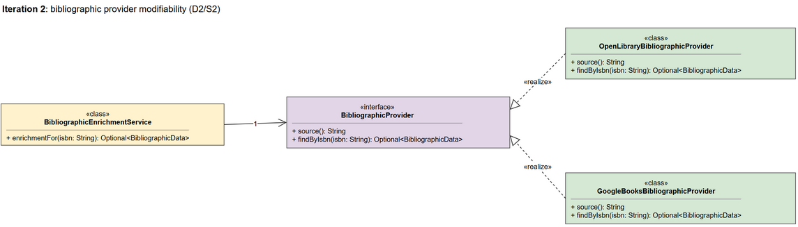
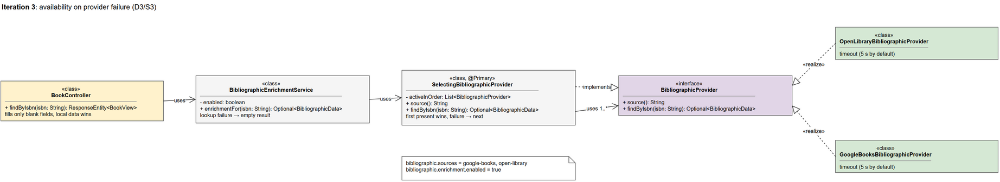
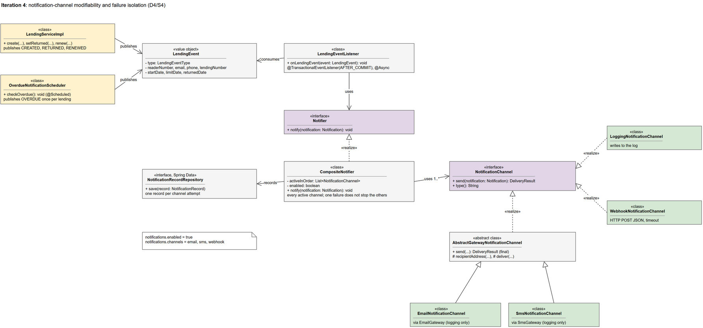
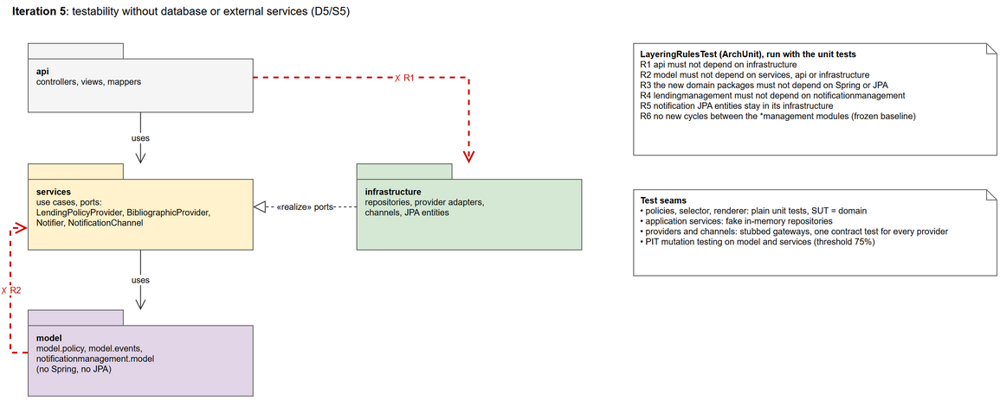

# ADD — Library Management System | Architectural Design Record

Design record of the current project, produced with Attribute-Driven Design from the base project
(commit `c716e06`). Each decision names the code and the commits that realise it. Results that were
measured or tested are distinguished from those that are only architecturally plausible.

The UML views are in [`add-views.drawio`](add-views.drawio), one page per iteration, exported to
`images/`.

## 1. Context and initial inputs (Step 1)

The LMS is a modular-monolith REST backend for Books, Authors, Genres, Readers, Lendings and Users, with
a database. The redesign adds two kinds of external dependency: ISBN-based bibliographic catalogues
(Google Books, Open Library) and reader notification channels (email, SMS, webhook). The architectural
focus is the Application Services of Lendings and Books, and a new Notifications module.

*Current project, C4 Level 2 (from [`lms-current-c4-views.drawio`](lms-current-c4-views.drawio)).*

| ID | Architectural driver | Importance | Risk | Impact |
|---|---|---|---|---|
| D1 | Lending-rule modifiability | High | High | High |
| D2 | Bibliographic provider modifiability | High | High | High |
| D3 | Availability on provider failure | High | High | Medium–High |
| D4 | Notification-channel modifiability and failure isolation | High | Medium | High |
| D5 | Testability without database or external services | Medium–High | Low | Medium |

**S1 (initial):** during maintenance, adding a lending policy must not modify the existing policies, and
a policy's limits (maximum lendings, periods, renewals) must change without a rebuild.

**S2 (initial):** during maintenance, adding or replacing a bibliographic provider must not modify the
consuming business logic; changes must be confined to the provider-specific implementation and its
configuration.

**S3 (initial):** during normal operation, when a provider becomes unavailable, book retrieval should
continue. The initial specification lacks explicit failure conditions and a measurable response.

**S4 (initial):** readers are notified of lending events through several channels; adding a channel
must not change the lending flow, and a failing channel must not affect lendings.

**S5 (initial):** the lending rules and the application services can be verified without a database or
external services, and layering violations are detected automatically.

## 2. Iteration 1 — D1/S1 Lending-rule modifiability

### Step 2 — Driver selection, relationships and roadmap

D1 is primary: in the base project the lending limits are hard-coded in `LendingServiceImpl`, the core
flow of the system, so every new rule would change it. D5 is related, because rules isolated from the
service can be tested on their own. D2–D4 are deferred. Roadmap v1: Iteration 1 D1; Iteration 2 D2;
candidate Iteration 3 D3; later D4 and D5.

Goal: make the lending rules a variation point, with policies selectable per reader and parameters set
by configuration.

### Step 3 — Target element

Lendings module / Application Services (`LendingServiceImpl`), which decides whether a reader may borrow
or renew and sets the limit date.

### Step 4 — Tactics and alternatives

Candidate modifiability tactics: Encapsulate, Reduce Coupling, Defer Binding (at configuration time for
the parameters, at runtime for the policy chosen per reader). The selected concept is a Strategy
interface with one implementation per policy, built by a factory from validated configuration.

| Alternative | Assessment |
|---|---|
| A1 — Conditionals in `LendingServiceImpl` | Simple, but every policy changes the service, and the rules can only be tested through it. |
| A2 — Policy interface + implementations + factory and selector | Selected: localises each policy, allows a different policy per reader, and keeps the rules free of Spring and JPA; adds abstraction. |
| A3 — One policy per deployment (Spring profile or `@ConditionalOnProperty`) | Configurable, but cannot give two readers different policies. |

### Steps 5–6 — Architectural elements, view and decision

*Iteration 1 resulting UML view.*

Decision: `LendingServiceImpl` obtains a `LendingPolicy` through `LendingPolicyProvider`.
`SelectingLendingPolicyProvider` builds the reader's lending history and asks the framework-free
`LendingPolicySelector` for a policy name. `LendingPolicyFactory` builds `StandardLendingPolicy` or
`AdaptiveLendingPolicy` from `LendingPolicyProperties` (`lending.policy.*`, validated at startup). Renewal
(`PATCH /api/lendings/{year}/{seq}/renew`) uses the same seam. Traceability: D1/S1 → Encapsulate / Defer
Binding → policy interface + factory + selector → localised policy changes.

Commits: `d3073aa`, `0f45b49`, `6a268aa`, `7701a2b`, `7e2e886`.

### Step 7 — Evaluation and consequences

- **S1 is addressed, and verified by the history.** The Adaptive policy was added in `6a268aa` without
  changing `StandardLendingPolicy`. That commit changed the factory, the properties and the shared
  `RenewalContext`, which gained the reader's active-lending count.
- **Testability improves.** The policies are tested without Spring or a database, and PIT kills 90% of
  the mutants in the policy package
  ([`mutation-analysis-adaptive-policy.md`](../testing/mutation-analysis-adaptive-policy.md)).
- **Consequences:**
  - each new policy still needs a factory branch;
  - the history is queried on every lending and renewal, two repository queries per request.

  Neither has a measured cost yet.

## 3. Iteration 2 — D2/S2 Bibliographic provider modifiability

### Step 2 — Driver selection, relationships and roadmap

D2 is primary; D3 is related, because the provider structure constrains later failover design.
Postponing D2 risks spreading provider-specific dependencies into the Book flow. D1/S1 is preserved.

Goal: design bibliographic integration so that providers can be added or replaced without changing the
consuming application logic.

### Step 3 — Target element

Books module / Application Services, which consume bibliographic information.

### Step 4 — Tactics and alternatives

Candidate modifiability tactics: Encapsulate, Reduce Coupling, Defer Binding. The selected concept is a
stable provider abstraction with one adapter per catalogue, mapping each wire format onto a neutral
`BibliographicData`.

| Alternative | Assessment |
|---|---|
| A1 — Direct provider dependency (WebClient in `BookServiceImpl`) | Simple, but changes propagate to consuming code, and the external format leaks into the Book flow. |
| A2 — Stable interface and adapters | Selected: localises variation and supports substitution; adds abstraction. |
| A3 — Generic HTTP gateway configured per provider | Centralises integration, but has broader responsibility; the mapping differs per provider anyway. |

### Steps 5–6 — Architectural elements, view and decision

*Iteration 2 resulting UML view.*

Decision: `BibliographicEnrichmentService` depends on `BibliographicProvider`;
`GoogleBooksBibliographicProvider` and `OpenLibraryBibliographicProvider` implement it. The port
separates "not found" (empty result) from "source failed" (`BibliographicLookupException`). Traceability:
D2/S2 → Encapsulate / Reduce Coupling → interface + adapters → localised provider changes.

Commits: `a7e77c5`, `cc449eb`, `8b84dfe`.

### Step 7 — Evaluation and consequences

- **S2 is addressed, and verified by the history.** Open Library was added in `8b84dfe` with changes only
  in its own package and in `application.properties`. One contract test runs against both adapters.
- **What it costs, and what is left.** Abstraction and configuration grow. Provider selection and failure
  handling remain unresolved, so S3 is carried forward for refinement.

## 4. Iteration 3 — D3/S3 Availability on provider failure

### Step 2 — Roadmap, goal and scenario refinement

D3/S3 becomes primary; D2/S2 is a constraint to preserve. The provisional goal is to keep book retrieval
working when a provider fails, without losing provider independence. S3 requires clarification of the
failure conditions, the operating assumptions and the response measure.

| S3 element | Refined specification |
|---|---|
| Source | Active bibliographic provider |
| Stimulus | Provider fails, times out or returns an unusable response |
| Environment | Normal operation; zero or more healthy alternatives |
| Artifact | Bibliographic integration of the Books module |
| Response | Serve the data through the next available provider without restart or changes to consuming logic; if none is available, return the book with its local data |
| Response measure | 100% of `GET /api/books/{isbn}` requests for an existing book return 200 during a provider outage |

The iteration goal is confirmed.

### Step 3 — Target element

Books / Application Services, preserving the abstraction established in Iteration 2.

### Step 4 — Availability design concepts

Tactic categories: Detect Faults and Recover from Faults. Selected tactics:
- **Timeout:** one per provider, 5 s by default.
- **Exception Detection:** each adapter turns transport and parsing errors into
  `BibliographicLookupException`.
- **Reconfiguration** to the next provider, in the order set in `bibliographic.sources`.
- **Graceful degradation:** with no provider, the book is returned with its local data.
- **A switch to turn the external lookup off:** `bibliographic.enrichment.enabled`.

Retry and Circuit Breaker were considered and left out.

| Alternative | Assessment |
|---|---|
| A1 — Selector over the providers, tried in order | Selected: one answer per lookup; the order is the precedence; preserves the adapters. |
| A2 — Query all providers in parallel and merge | Lower latency on failure, but needs a merge rule for conflicting data and pays for every provider on every read. |
| A3 — Enrich once at book creation and store the copy | No external call on reads, but creation depends on the providers and the copy goes stale. |

### Steps 5–6 — Resulting view and architectural decision

*Iteration 3 provider-availability solution.*

Decision: introduce `SelectingBibliographicProvider` (`@Primary`), which implements and uses
`BibliographicProvider`, preserving the existing adapters. The port gains `source()` so that providers
are named in configuration; an unknown name fails at startup. `BibliographicEnrichmentService` turns a
total failure into an empty result, and `BookController` fills only blank fields. Traceability: D3/S3 →
Timeout + Exception Detection + Reconfiguration → `SelectingBibliographicProvider` / fallback →
continuity through an alternative provider, or the local data.

Commits: `49f35e6`, `fe77b1b`.

### Step 7 — Evaluation and new concerns

- **What the tests verify.** With stubbed providers:
  - a failing provider falls through to the next (`SelectingBibliographicProviderTest`);
  - the multi-provider fallback reaches the REST response (`BookEnrichmentSystemApiIT`);
  - a provider failure still returns the local book (`BookEnrichmentComponentIT`).
- **What is not measured.** The 100% response measure has not been run against real provider outages.
- **Consequence: adding `source()` changed the port.** It was an additive change that touched both
  adapters.
- **Consequence: waiting for timeouts.** When every provider times out, a read waits for all of them in
  turn: up to 10 s with the two defaults.
- **New S3b, carried to the backlog:** during a provider outage, 95% of book retrievals should complete
  within 2 seconds. No solution is preselected; a circuit breaker is the obvious candidate.

## 5. Iteration 4 — D4/S4 Notification-channel modifiability and failure isolation

### Step 2 — Driver selection, relationships and roadmap

D4 is primary. D1/S1 is a constraint, because the triggers live in the lending flow that Iteration 1
shaped. D3's lesson applies: external delivery can fail and must not affect the caller. Refined S4:
- **Modifiability:** a new channel is one adapter plus its configuration, with zero changes to the
  lending flow.
- **Isolation:** a failing channel neither rolls back nor delays a lending, and does not stop the other
  channels.
- **Visibility:** every delivery attempt is recorded.

Goal: notify readers of lending events (created, renewed, returned, overdue) through any number of
channels, without making the lending flow depend on notifications.

### Step 3 — Target element

Lendings / Application Services (the event sources), and a new Notifications module.

### Step 4 — Tactics and alternatives

Tactics:
- **Modifiability:** Encapsulate, Use an Intermediary (events), Restrict Dependencies, Defer Binding of
  the active channels.
- **Availability:** Exception Detection, fault isolation per channel.
- **Recording:** an audit of every delivery attempt.

The lending flow and the notification module communicate through an in-process event, and each channel
sits behind a port.

| Alternative | Assessment |
|---|---|
| A1 — `LendingServiceImpl` calls an email service directly | Simple, but a channel outage rolls back or delays the lending; each new channel edits the lending flow. |
| A2 — Event delivered after commit, asynchronously, sent to every active channel | Selected: the lending never waits for or depends on delivery; one adapter per channel. |
| A3 — Message broker with a transactional outbox | Survives a restart between commit and delivery, but adds infrastructure to every environment for a single in-process consumer. |

### Steps 5–6 — Architectural elements, view and decision

*Iteration 4 resulting UML view.*

Decision:
- **Publishing.** `LendingServiceImpl` and the scheduled `OverdueNotificationScheduler` publish an
  immutable `LendingEvent` snapshot.
- **Receiving.** `LendingEventListener` receives it after the transaction commits, on another thread.
- **Delivery.** `CompositeNotifier` implements `Notifier` and sends the notification to every active
  `NotificationChannel`. Email and SMS share `AbstractGatewayNotificationChannel`; there are also
  webhook and logging channels.
- **Audit.** One `NotificationRecord` is saved per channel attempt.
- **Direction.** Lending never depends on Notifications; ArchUnit enforces this.

Traceability: D4/S4 → Use an Intermediary + Encapsulate + fault isolation → event + `Notifier` /
`NotificationChannel` → channels added without touching the lending flow.

Commits: `8ab3d8d`, `4fead80`, `b51c17c`, `c3bd6a5`, `9691639`.

### Step 7 — Evaluation and new concerns

- **The modifiability part of S4 is addressed.** The webhook was added in `c3bd6a5` with new files only.
  Adding SMS in `b51c17c` moved the shared logic out of the email channel into
  `AbstractGatewayNotificationChannel`.
- **The isolation part is verified with stubs.** `CompositeNotifierTest` shows that one failing channel
  does not stop the others, and that a failure is recorded with its reason. `NotificationTriggerIT` and
  `NotificationFanoutSystemApiIT` cover the triggers and the delivery through the REST flow.
- **New concerns:**
  - an event still waiting for delivery is lost if the application stops;
  - the email and SMS gateways only log, so no real provider is integrated;
  - `CompositeNotifier` (application services) imports the repository and the JPA entity from the
    module's infrastructure package. That dependency points outwards, and no ArchUnit rule catches it.

## 6. Iteration 5 — D5/S5 Testability without database or external services

### Step 2 — Driver selection, relationships and roadmap

D5 is primary; Iterations 1–4 are constraints to preserve. The goal is to keep the seams created in
those iterations testable, and to stop the layering from eroding further.

### Step 3 — Target element

The internal structure of every module: `api`, `services`, `model`, `infrastructure`.

### Step 4 — Tactics and alternatives

Testability tactics:
- **Separate Interface from Implementation:** fakes and stubs behind every port.
- **Limit Structural Complexity:** framework-free domain packages and no new module cycles.
- **Executable Assertions:** constructors validate their values.
- **Sandbox:** fake in-memory repositories and stubbed gateways.

| Alternative | Assessment |
|---|---|
| A1 — Rely on code review | No cost, but erosion goes unnoticed. |
| A2 — Executable architecture rules (ArchUnit) and framework-free new domain | Selected: every build checks the rules; the existing cycles are frozen as a baseline, so only new ones fail. |
| A3 — Make the whole domain framework-free first | Cleanest result, but rewrites every JPA entity of the base project. |

### Steps 5–6 — Architectural elements, view and decision

*Iteration 5 resulting UML package view.*

Decision:
- **Layering rules.** `LayeringRulesTest` checks rules R1–R6 with the unit tests.
- **Framework-free domain.** The policy, event and notification-model packages stay free of Spring and
  JPA.
- **Unit tests.** Application services are unit-tested with fake in-memory repositories.
- **External calls.** Providers and channels are tested with stubbed gateways.
- **Mutation testing.** PIT runs on `model` and `services`, with a 75% threshold.

Traceability: D5/S5 → Limit Structural Complexity + Sandbox → ArchUnit rules + test seams → rules
verified on every build.

Commits: `059a2df`, `0a38ae3`, `08b9b02`, `abb4512`, `ffbdb79`, `f4f1586`, `3eea966`.

### Step 7 — Evaluation and new concerns

- **S5 is addressed.** The rules run on every build, and the domain packages are tested without Spring or
  a database.
- **New concern: the cycle rule does not protect CI.** The frozen baseline (`archunit_store/`) is ignored
  by `.gitignore`, so a fresh clone (as in CI) records the cycles it finds instead of comparing against
  the baseline, and the no-new-cycles rule cannot fail there.
- **New concern: a gap in the rules.** No rule forbids `services` from depending on `infrastructure`, the
  case found in Iteration 4.

## 7. Cross-iteration synthesis

| Iteration | Decision | Evaluation / carry-forward |
|---|---|---|
| 1 — D1/S1 | `LendingPolicy` + factory + per-reader selector, validated configuration | S1 verified by `6a268aa`; history queried on every request. |
| 2 — D2/S2 | `BibliographicProvider` + adapters | S2 verified by `8b84dfe`; S3 needs refinement. |
| 3 — D3/S3 | `SelectingBibliographicProvider` and fallback, best-effort enrichment | S3 verified with stubs, not against real outages; S3b (latency during outage) emerges. |
| 4 — D4/S4 | Lending events after commit, `CompositeNotifier`, channel adapters, delivery audit | Modifiability and isolation addressed; event loss on crash, logging-only gateways and the services → infrastructure dependency remain. |
| 5 — D5/S5 | ArchUnit rules, framework-free domain, fakes and stubs, PIT | Rules on every build; the cycle baseline is not versioned, and services → infrastructure is unchecked. |

ADD steps describe activities rather than separate deliverables. The same UML view is instantiated in
Step 5 and recorded with its rationale in Step 6. Each iteration updates the architectural
understanding, including the risks and scenarios carried forward.
