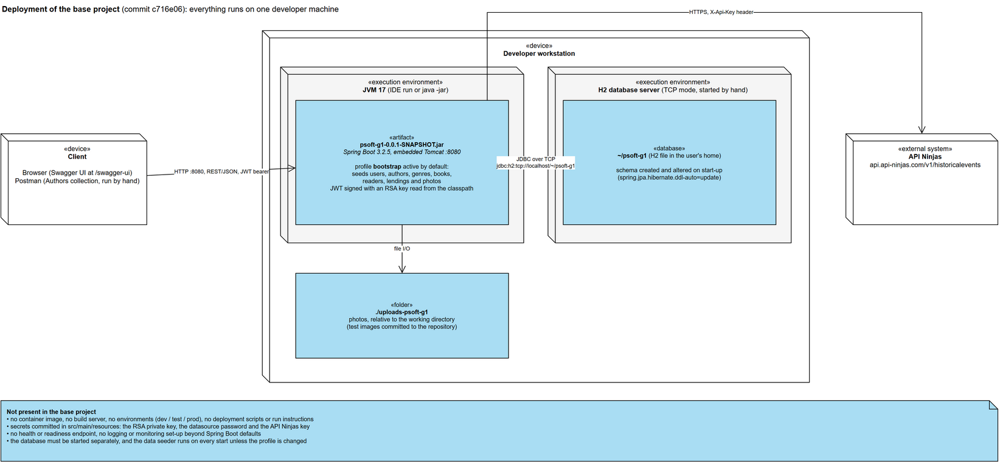
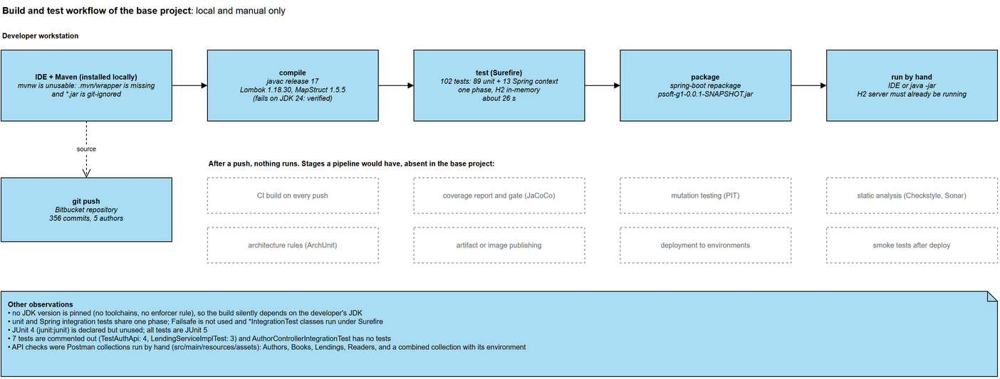
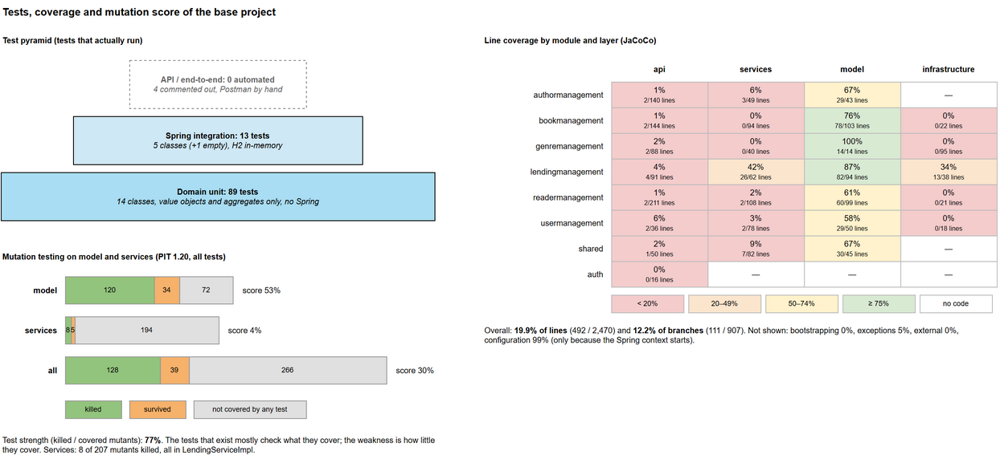

# State of the base project

This document records the state of the Library Management System as its original team left it, before any of
the current project's changes. It covers four aspects: implementation and deployment, build and testing practices,
test quantity, coverage and effectiveness, and software quality indicators. It describes the system as it
is; problems are recorded, not fixed.

**Baseline.** Commit `c716e06`, the last commit of the base project's team. The history before it has
356 commits by 5 authors.

**How the numbers were obtained.** The base commit was exported to a separate folder and measured there, on
Maven 3.9 and JDK 24. The base code does not compile on that JDK (see section 2), so in the measurement copy
only, Lombok was raised from 1.18.30 to 1.18.38 and Byte Buddy to 1.17.5. No source or test file was
changed. The tools were JaCoCo 0.8.12, PIT 1.20.0 with its JUnit 5 plugin, and Checkstyle 10.23.1 with this
repository's own `config/checkstyle` rules, so later measurements are comparable. The commands are listed
at the end.

The diagrams are in [`base-project-state.drawio`](base-project-state.drawio) (one page per diagram), with
PNG exports in `images/`. The architecture of the same baseline is described by the C4 views in
[`docs/architecture/lms-base-c4-views.drawio`](../../architecture/lms-base-c4-views.drawio).

---

## 1. Implementation and deployment

### 1.1 Implementation

The LMS is a single Spring Boot application exposing a REST API, organised as a modular monolith of
twelve top-level packages.

| Aspect | Base project state |
|---|---|
| Language and runtime | Java 17 (`maven.compiler.release` 17) |
| Framework | Spring Boot 3.2.5: Spring MVC, Spring Data JPA (Hibernate), Spring Security |
| Authentication | OAuth2 resource server with self-issued JWTs, signed with an RSA key pair read from the classpath |
| Database | H2, in TCP server mode (`jdbc:h2:tcp://localhost/~/psoft-g1`), schema generated by Hibernate (`ddl-auto=update`) |
| External integration | API Ninjas historical events, called through Spring WebFlux `WebClient` |
| API documentation | springdoc OpenAPI 2.3.0, Swagger UI at `/swagger-ui` |
| Code generation | Lombok 1.18.30 and MapStruct 1.5.5 annotation processors |
| Other libraries | Bean Validation, OWASP Java HTML Sanitizer |

| Package | Role | Main files | Lines of code |
|---|---|---|---|
| `readermanagement` | Readers subdomain | 20 | 1,058 |
| `bookmanagement` | Books subdomain | 19 | 935 |
| `lendingmanagement` | Lendings subdomain | 20 | 812 |
| `bootstrapping` | demo data seeder (profile `bootstrap`) | 2 | 699 |
| `authormanagement` | Authors subdomain | 15 | 592 |
| `usermanagement` | users, librarians and readers' accounts | 15 | 530 |
| `shared` | photos, file storage, forbidden names, paging | 20 | 522 |
| `genremanagement` | Genres subdomain | 15 | 477 |
| `configuration` | security, JPA auditing, OpenAPI, WebClient | 4 | 241 |
| `exceptions` | exception types and the global handler | 5 | 197 |
| `auth` | login endpoint | 2 | 77 |
| `external` | API Ninjas client | 2 | 36 |
| **Total** | | **140** | **6,185** |

Lines of code exclude blank and comment lines. Each subdomain package follows the same internal layout:
`api` (controllers, views, view mappers), `services`, `model`, `repositories` (interfaces) and
`infrastructure` (Spring Data implementations). The REST API has **49 endpoints** in seven controllers:
Readers 13, Books 10, Authors 9, Lendings 6, user administration 5, Genres 4, and authentication 2.

The C4 views show that the module boundaries are not respected. Modules use each other's repositories and
domain entities and query each other's tables. There are dependency cycles between Author and Book, Book and
Genre, Book and Lending, Lending and Reader, and between Shared and Author, Book, Lending and Reader. The
Level 3 view of Readers marks these violations in red. Section 4 summarises them as quality indicators.

### 1.2 Deployment



The base project had no deployment beyond running the application on a developer's machine:

- **Packaging.** `spring-boot-maven-plugin` repackages the build into
  `psoft-g1-0.0.1-SNAPSHOT.jar`. There is no Dockerfile or container image, and no artifact is published
  anywhere.
- **Running.** The application is started from the IDE or with `java -jar`. Before that, an H2 server
  has to be started by hand in TCP mode, because the datasource points to `tcp://localhost`. There are no
  run instructions: `HELP.md` is the unedited Spring Initializr file.
- **Data.** The `bootstrap` profile is active by default (`spring.profiles.active=bootstrap`). The
  seeders run on every start and insert users, authors, genres, books, readers, lendings and photos. The schema is
  created and altered by Hibernate at start-up, with no migration tool.
- **Files.** Photos are stored in `uploads-psoft-g1`, a path relative to the working directory. Test
  photos are committed in that folder.
- **Configuration and secrets.** One `application.properties` file serves every purpose. The RSA private
  key used to sign JWTs, the datasource password and the API Ninjas key are committed to the repository,
  in `src/main/resources`.
- **Environments and operations.** There is only one implicit environment, the developer's machine. There
  is no health or readiness endpoint (Spring Boot Actuator is not a dependency) and no logging or
  monitoring configuration beyond the defaults.

---

## 2. Build and testing practices



**Build.**

- **Maven is the build tool, but the Maven wrapper does not work.** `mvnw` and `mvnw.cmd` are committed
  without the `.mvn/wrapper` directory, and `.gitignore` excludes `*.jar`, so the wrapper jar could never
  have been committed. A locally installed Maven is required.
- **No JDK version is enforced.** There is no toolchain or Maven Enforcer rule, so the build depends on
  whichever JDK the developer has.
  - On JDK 24 the compiler fails with `ExceptionInInitializerError: com.sun.tools.javac.code.TypeTag ::
    UNKNOWN`. Lombok 1.18.30 does not support recent JDKs.
  - The build was only reproducible on the JDK versions the team happened to use.
- **The POM has only the Spring Boot plugin and the compiler plugin.** There is no coverage, mutation,
  static-analysis, formatting or architecture-rule tooling.
- **`junit:junit` (JUnit 4) is declared but unused.** All tests are JUnit 5.

**Continuous integration and delivery.** There is none. The repository has no pipeline definition, and a
push to Bitbucket triggers nothing. Building, testing and running were all manual, on each developer's
machine.

**Testing practices.**

- **Tests run with `mvn test` in a single Surefire phase.** Unit tests and Spring integration tests are
  mixed. Failsafe is not used, so the `*IntegrationTest` classes run as ordinary unit tests. Integration
  tests use an in-memory H2 database (`src/test/resources/application.properties`), so they need no
  external service.
- **Naming is inconsistent:** `*Test`, `*IntegrationTest`, `*Tests`, and a `Test*` prefix
  (`TestAuthApi`). `LendingServiceImplTest` is named as a unit test but starts the full Spring context.
- **Test doubles:**
  - Mockito is used in one class (`AuthorServiceImplIntegrationTest`), through `@MockBean`.
  - `UserTestDataFactory` and `JsonHelper` are shared helpers for the API test, which is commented out.
- **Disabled and empty tests:** 7 tests are disabled by commenting them out: all 4 in `TestAuthApi` and 3
  in `LendingServiceImplTest`. `AuthorControllerIntegrationTest` declares a `@WebMvcTest` but contains no
  tests.
- **API testing was manual:** Postman collections for Authors, Books, Lendings and Readers, plus a combined
  collection with its environment, are kept in `src/main/resources/assets`.

---

## 3. Test quantity, coverage and effectiveness



### 3.1 Quantity

The suite runs **102 tests, all passing**, in about 26 seconds.

| Kind | Classes | Tests | What they exercise |
|---|---|---|---|
| Domain unit tests, no Spring | 14 | 89 | value objects and aggregates (`Isbn`, `Title`, `Lending`, `ReaderDetails`, ...) |
| Spring integration tests | 5 (+1 empty) | 13 | context start-up, two repositories, two services |
| API or end-to-end tests | 0 | 0 | 4 written, all commented out |

| Module | Tests | Of which integration |
|---|---|---|
| `lendingmanagement` | 32 | 10 (repository 7, service 3) |
| `bookmanagement` | 24 | 0 |
| `readermanagement` | 17 | 0 |
| `authormanagement` | 16 | 2 |
| `shared` | 8 | 0 |
| `genremanagement` | 4 | 0 |
| application context | 1 | 1 |
| `usermanagement`, `auth`, `external`, `configuration`, `exceptions`, `bootstrapping` | 0 | 0 |

There are 1,245 lines of test code against 6,185 lines of production code, a ratio of about 1 to 5.

### 3.2 Coverage

| Scope | Lines | Branches |
|---|---|---|
| **Whole application** | **19.9%** (492 / 2,470) | **12.2%** (111 / 907) |
| `model` packages | 71.9% | 57.8% |
| `services` packages | 7.8% | 3.2% |
| `api` packages (controllers, views, mappers) | 1.9% | 0.0% |
| `infrastructure` packages (custom queries) | 6.7% | 0.0% |
| `bootstrapping` | 0.0% | 0.0% |

Coverage is concentrated in the domain model. The application services are nearly untested: only
`LendingServiceImpl` has meaningful coverage (42%). The REST layer is untested apart from what loading the
Spring context touches. The custom query implementations are untested except for one Lending repository
test. The `configuration` package shows 99% only because every Spring test loads it; no test checks the
security rules. The heat map above gives the breakdown by module and layer.

### 3.3 Effectiveness

Mutation testing was run with PIT on the `model` and `services` packages (request DTOs and MapStruct
mappers excluded), against all tests.

| Scope | Mutants | Killed | Survived | Not covered | Mutation score | Test strength |
|---|---|---|---|---|---|---|
| `model` | 226 | 120 | 34 | 72 | 53% | 78% |
| `services` | 207 | 8 | 5 | 194 | 4% | 62% |
| **Total** | **433** | **128** | **39** | **266** | **30%** | **77%** |

The mutation score is the share of all mutants killed. Test strength is the share killed among the mutants
the tests reach. A test strength of 77% means the existing tests mostly do check what they execute; the low
overall score comes from how little they execute. 61% of the mutants are in code that no test runs. By
module, the domain models of Genre (83%), Book (64%) and Shared (61%) are the best tested. User (23%) and
the services of Author, Book, Genre, Reader, Shared and User (0%) are the weakest.

Reading the tests confirms this, and shows some tests that cannot fail:

- `PsoftG1ApplicationTests.contextLoads` asserts `assertTrue(true)`. It only shows that the context
  starts.
- `AuthorServiceImplIntegrationTest` mocks `searchByNameName`, then calls `findByAuthorNumber`. The mock
  returns an empty `Optional`, so the assertion inside `ifPresent` never runs and the test passes whatever
  the service does.
- No test exercises authorisation, although the controllers contain access rules (for example, a reader
  may only see their own lendings).

The domain tests are mostly sound, assertion-rich checks of validation rules. They make up 87% of the
suite.

---

## 4. Software quality indicators

| Indicator | Value | Notes |
|---|---|---|
| Size | 140 main files, 6,185 lines of code; 23 test files, 1,245 lines | measured on hand-written sources |
| Cyclomatic complexity | 912 over 458 methods (JaCoCo, including generated mappers) | average about 2 per method |
| Complexity hot spots | `Bootstrapper` 95, `ReaderController` 44, `BookServiceImpl` 37, `ReaderServiceImpl` 33, `BookController` 29 | none of these classes is covered by tests |
| Largest classes | `Bootstrapper` 536 lines, `ReaderController` 352, `UserBootstrapper` 271, `Lending` 261 | |
| Line coverage | 19.9% | section 3.2 |
| Branch coverage | 12.2% | section 3.2 |
| Mutation score | 30% (test strength 77%) | section 3.3 |
| Checkstyle warnings | **5,682**, in all 140 main files | this repository's rules (Google style); section 4.1 |
| Commented-out code | about 28 lines in main code, plus 7 commented-out tests | heuristic count |
| TODO / FIXME markers | 1 | |
| Architecture conformance | 5 dependency cycles between modules; 7 boundary or layering violations in the Readers module alone | C4 Level 2 and Level 3 views |
| Build reproducibility | broken wrapper; fails on current JDKs; no JDK pinned | section 2 |
| Secrets in source control | 3 (JWT signing key, database password, API key) | section 1.2 |
| Duplication | not measured | no duplication tool ran on the baseline |

### 4.1 Checkstyle breakdown

| Rule | Warnings |
|---|---|
| Indentation | 3,023 |
| FileTabCharacter | 689 |
| WhitespaceAround | 447 |
| LineLength | 357 |
| CustomImportOrder | 324 |
| WhitespaceAfter | 260 |
| OperatorWrap | 131 |
| EmptyLineSeparator | 115 |
| NeedBraces | 67 |
| SummaryJavadoc | 53 |
| JavadocParagraph | 39 |
| AvoidStarImport | 33 |
| other rules | 144 |

Almost all warnings are formatting: indentation, tabs, whitespace, line length and import order. They are
the result of no formatter or style check being part of the build, not of design problems. The few
behaviour-related rules are `NeedBraces` (67 `if`/`for` bodies without braces) and `AvoidStarImport`.

### 4.2 Architecture indicators

Section 1.1 and the C4 views describe the architecture in detail. As indicators:

- **Cycles:** Author, Book, Genre, Lending, Reader and Shared all take part in at least one cycle; only
  User and Auth do not. This makes those modules impossible to build, test or replace independently.
- **Boundary violations:** in Readers alone, the service layer injects four repositories from other
  modules, the domain entity holds other modules' entities, and queries join four other modules' tables.
  The thick, API-bypassing dependencies in the Level 2 view show the same pattern in Author, Book, Genre
  and Lending.
- **Layering:** controllers contain use-case and authorisation logic, call an external HTTP client
  directly, and work with domain entities.
- **Framework coupling:** domain entities carry JPA annotations, and repository interfaces expose
  Spring Data types.

---

## 5. Summary

- **Implementation:** a reasonably structured Spring Boot modular monolith, whose module boundaries are
  eroded by cross-module repository use, shared entities and cross-table queries.
- **Deployment:** none beyond a developer's machine. There is no container, no environment separation and
  no health endpoint, secrets are committed, and the database server is started by hand.
- **Build and testing practices:** manual and local only. There is no CI, the wrapper is broken, the
  build does not work on current JDKs, and there is no quality tooling of any kind.
- **Tests:** 102 passing tests that cover 20% of lines. The domain model is reasonably tested; services,
  controllers, queries, security and the external integration are essentially untested. Mutation score
  is 30%: the tests that exist are fairly effective, but most of the code is never exercised. Two
  integration tests cannot fail.
- **Quality indicators:** about 5,700 style warnings, complexity concentrated in untested controllers,
  services and the data seeder, five inter-module cycles, and three committed secrets.

---

## Reproducing the measurements

The measurements were run on a copy of commit `c716e06`, with Lombok 1.18.38 and Byte Buddy 1.17.5 set in
that copy's POM. PIT and Checkstyle were added to the copy's POM with the configuration this repository
uses.

```bash
# tests and coverage
mvn -B -Dmaven.test.failure.ignore=true \
    org.jacoco:jacoco-maven-plugin:0.8.12:prepare-agent test \
    org.jacoco:jacoco-maven-plugin:0.8.12:report

# mutation testing (targetClasses: *.model.*, *.services.*; excluded: *Request, *Mapper, *MapperImpl)
mvn -B org.pitest:pitest-maven:mutationCoverage

# style (config/checkstyle from this repository, failOnViolation=false)
mvn -B checkstyle:check
```
