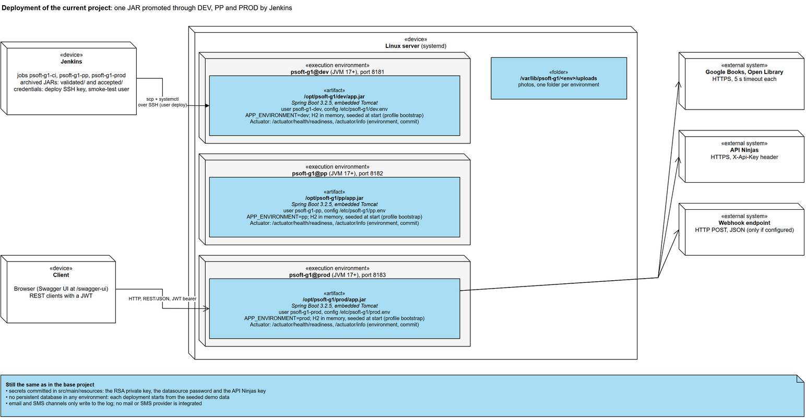
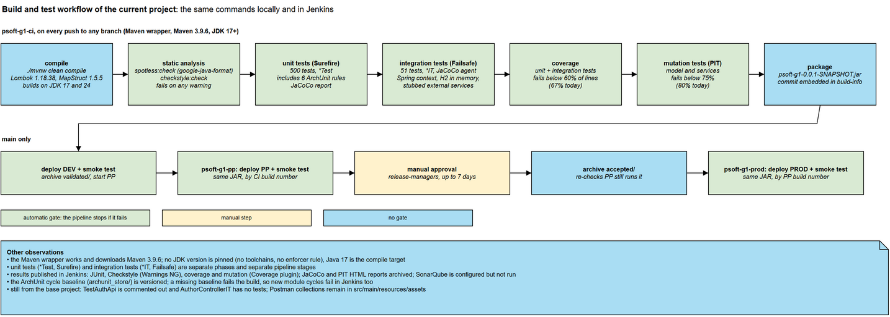
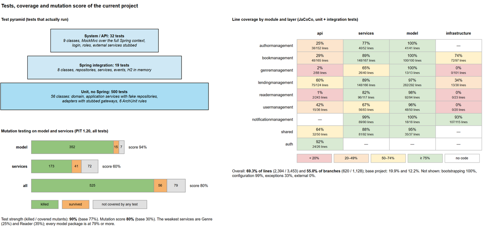

# State of the current project

This document records the state of the Library Management System after the current project's changes. It
covers the same four aspects as the [base project report](../system-as-is/base-project-state.md), measured
the same way, so the two can be compared: implementation and deployment, build and testing practices, test
quantity, coverage and effectiveness, and software quality indicators. It describes the system as it is.
Problems are recorded, not fixed.

**Measured code.** `036945f` on `main`, plus the changes committed with this report: the coverage stage and
reports in the pipeline, the 60% coverage gate, the versioned ArchUnit baseline, and the new and rewritten
tests. Since the base project (`c716e06`) there are 50 commits (48 without merges) by 2 authors.

**How the numbers were obtained.** The commit was exported to a separate folder and measured there, on the
Maven wrapper (Maven 3.9.9) and JDK 24. Coverage counts the unit and the integration tests together, with
JaCoCo 0.8.12. In the measurement copy only, the JaCoCo exclusions of the project's POM were removed, so
coverage is reported for all classes, as it was for the base project. Mutation testing used the project's
own PIT configuration (PIT 1.20.0, `model` and `services`, request classes and mappers excluded), the same
target classes as for the base project. Checkstyle used this repository's `config/checkstyle` rules.
The commands are listed at the end.

The diagrams are in [`current-project-state.drawio`](current-project-state.drawio) (one page per
diagram), with PNG exports in `images/`. The architecture of the same code is described by the C4 views in
[`docs/architecture/lms-current-c4-views.drawio`](../../architecture/lms-current-c4-views.drawio), and the
design decisions by the ADD record in [`docs/architecture/add.md`](../../architecture/add.md).

---

## 1. Implementation and deployment

### 1.1 Implementation

The LMS is still a single Spring Boot application exposing a REST API, organised as a modular monolith. It
now has thirteen top-level packages: `notificationmanagement` is new.

| Aspect | Current project state | Change since the base project |
|---|---|---|
| Language and runtime | Java 17 (`maven.compiler.release` 17), builds on JDK 17 and 24 | builds on recent JDKs |
| Framework | Spring Boot 3.2.5: Spring MVC, Spring Data JPA (Hibernate), Spring Security, Actuator | Actuator added |
| Authentication | OAuth2 resource server with self-issued JWTs, signed with an RSA key pair read from the classpath | unchanged |
| Database | H2, in the deployed environments in memory, configured per environment, with the schema generated by Hibernate | no longer an H2 server started by hand |
| External integration | API Ninjas, Google Books and Open Library (book data), webhook (notifications), all through Spring WebFlux `WebClient` | two catalogues and a webhook added |
| Asynchronous work | lending events handled after commit with `@Async`, and a scheduled overdue sweep (`@Scheduled`) | new |
| Configuration | lending policies, bibliographic sources and notification channels in `application.properties`, validated at startup, overridable per environment | new |
| API documentation | springdoc OpenAPI 2.3.0, Swagger UI at `/swagger-ui` | unchanged |
| Code generation | Lombok 1.18.38 and MapStruct 1.5.5 | Lombok upgraded |

| Package | Role | Main files | Lines of code | Base project |
|---|---|---|---|---|
| `lendingmanagement` | Lendings subdomain, lending policies, lending events | 39 | 1,677 | 812 |
| `bookmanagement` | Books subdomain, bibliographic providers | 36 | 1,392 | 935 |
| `readermanagement` | Readers subdomain | 26 | 1,184 | 1,058 |
| `bootstrapping` | demo data seeder (profile `bootstrap`) | 2 | 984 | 699 |
| `notificationmanagement` | reader notifications: channels, delivery audit | 28 | 634 | n/a |
| `authormanagement` | Authors subdomain | 15 | 624 | 592 |
| `usermanagement` | users, librarians and readers' accounts | 17 | 565 | 530 |
| `genremanagement` | Genres subdomain | 17 | 539 | 477 |
| `shared` | photos, file storage, forbidden names, paging | 20 | 528 | 522 |
| `configuration` | security, JPA auditing, OpenAPI, WebClient | 4 | 316 | 241 |
| `exceptions` | exception types and the global handler | 5 | 212 | 197 |
| `auth` | login endpoint | 2 | 87 | 77 |
| `external` | API Ninjas client | 2 | 36 | 36 |
| **Total** (with the application class) | | **214** | **8,787** | **6,185** |

Lines of code exclude blank and comment lines, counted as for the base project. Part of the growth is
reformatting: running google-java-format through Spotless rewrapped long lines, for example in
`Bootstrapper` (536 lines before, 752 after). The REST API has **50 endpoints** in seven controllers:
Readers 13, Books 10, Authors 9, Lendings 7 (renewal added), user administration 5, Genres 4, and
authentication 2. `GET /api/books/{isbn}` now also fills a blank description from the external catalogues.

The module boundaries are as they were in the base project, apart from the changes below. The C4 views of
the current project show the details.
- **Still present:** the cross-module repository use, the shared entities, the cross-table queries and the
  five dependency cycles.
- **Fixed:** three domain classes (`Author`, `Book`, `ReaderDetails`) no longer use service-layer
  request classes.
- **New:** the Notifications module depends on Lending in one direction only. Its service layer uses a
  repository and an entity from its own infrastructure package, a dependency pointing outwards.

### 1.2 Deployment



The application is now deployed to three environments by Jenkins.

- **Packaging.** `spring-boot-maven-plugin` builds `psoft-g1-0.0.1-SNAPSHOT.jar`, with the Git commit
  embedded in its build information. The JAR is built once, in CI, and the same file is promoted to every
  environment. Jenkins archives it (`validated/` after DEV, `accepted/` after PP). There is no container
  image.
- **Environments.** One Linux server runs three systemd services, `psoft-g1@dev`, `@pp` and `@prod`, on
  ports 8181, 8182 and 8183 by default. Each service has:
  - its own system user
  - a JAR folder (`/opt/psoft-g1/<env>`)
  - an uploads folder (`/var/lib/psoft-g1/<env>`)
  - a configuration file (`/etc/psoft-g1/<env>.env`).

  The units are hardened (`NoNewPrivileges`, `ProtectSystem=strict`, `PrivateTmp`). `setup-environments.sh`
  creates all of this, and only allows the `deploy` account to start and stop these three services.
- **Delivery.** Jenkins copies the JAR over SSH and restarts the service, then runs `deploy/smoke-test.sh`.
  The smoke test checks four things:
  - that `/actuator/info` reports the expected environment and commit
  - that `/actuator/health/readiness` is UP
  - that a seeded user can log in and call the API
  - that a request without a token is rejected.

  PROD only receives a JAR that a release manager accepted in PP. A rollback means re-running the PROD job
  with an earlier PP build.
- **Data.** Each environment uses an in-memory H2 database seeded by the `bootstrap` profile. Data does not
  survive a restart or a deployment.
- **Configuration and secrets.**
  - Environment-specific values (port, datasource, upload folder, environment name) are in each
    environment's `.env` file. The feature settings (lending policies, sources, channels) can be overridden
    there too.
  - The RSA private key, the datasource password and the API Ninjas key are still committed in
    `src/main/resources`.
- **Operations.** Actuator exposes `health` (with liveness and readiness probes) and `info`. Logging uses
  the Spring Boot defaults and goes to the systemd journal. Every notification attempt is recorded in the
  `NOTIFICATION_RECORD` table. Email and SMS are delivered through
  logging gateways; a mail or SMS provider plugs in as another gateway implementation.

---

## 2. Build and testing practices



**Build.**

- **The Maven wrapper works.** `.mvn/wrapper/maven-wrapper.properties` is committed and the script
  downloads the wrapper and Maven 3.9.6. A local Maven installation is not needed.
- **The build works on current JDKs.** Lombok 1.18.38 and Byte Buddy 1.17 replace the versions that failed
  on JDK 24. Java 17 remains the compile target. No JDK version is enforced (no toolchain, no Enforcer rule).
- **Quality tooling in the POM:**
  - JaCoCo: report at `test`, plus a 10% line-coverage gate at `verify`
  - PIT, with a 75% mutation threshold
  - Checkstyle, failing on any warning
  - Spotless with google-java-format, run manually
  - ArchUnit 1.3.0, as a test dependency
  - the SonarQube scanner, for on-demand analysis (`./mvnw sonar:sonar`) outside the pipeline.
- **JUnit 4 is no longer declared.** All tests are JUnit 5.

**Continuous integration and delivery.** Three Jenkins pipelines are in the repository: `jenkins/`, and
`deploy/` for the deployment scripts.
- **`psoft-g1-ci`** runs on every push to any branch. Its stages are compile, Spotless and Checkstyle, unit
  tests, integration tests, PIT and package. On `main` it then deploys to DEV and smoke-tests it.
- **`psoft-g1-pp`** deploys the same JAR to PP, smoke-tests it and waits for a manual approval.
- **`psoft-g1-prod`** deploys the accepted JAR to PROD.

Each check stops the pipeline when it fails:
- **Integration tests** run with the JaCoCo agent, so a Coverage stage measures unit and integration
  tests together and fails below 60% of lines.
- **Results are published in Jenkins:** test results, Checkstyle issues (Warnings NG), coverage and
  mutation (Coverage plugin), with the HTML reports archived.
- **Locally,** `./mvnw verify` runs the same unit tests, integration tests, coverage gate and Checkstyle.

**Testing practices.**

- **Unit and integration tests are separate.** `*Test` classes run under Surefire (`./mvnw test`). `*IT`
  classes run under Failsafe and start the Spring context with an in-memory H2 database. They are separate
  pipeline stages.
- **Architecture rules are tests.** `LayeringRulesTest` checks six ArchUnit rules with the unit tests: no
  `api` → `infrastructure` dependency, no outward dependency from `model`, a framework-free new domain, a
  one-way Lending → Notifications edge, the notification entities kept in infrastructure, and no new
  cycles between modules. The cycle rule compares against a versioned baseline in `archunit_store/` (the
  10 cycles the base project's dependencies form). A missing baseline fails the build, so new cycles also
  fail in Jenkins.
- **Test doubles:**
  - fake in-memory repositories for the application services (12 test classes use them)
  - stubbed gateways for the bibliographic providers and notification channels
  - one contract test (`BibliographicProviderContractTest`) run against every provider adapter.

  Mockito remains in four unit-test classes: `LendingEventTest`, `OverdueNotificationSchedulerTest`,
  `CompositeNotifierTest` and `CompositeNotifierSelectionConfigTest`.
- **System tests through the REST API:** nine classes (the `*SystemApiIT` and `*ComponentIT` classes,
  `BookEnrichmentDisabledApiIT` and `DeploymentEndpointsIT`) use MockMvc over the full Spring context.
  The external services in them are stubbed. `AuthenticationAndAuthorisationSystemApiIT` logs in for real
  and checks access by role and the "own lendings only" rule.
- **Naming is consistent:** `*Test` for unit tests and `*IT` for integration tests, except `TestAuthApi`.
- **Kept from the base project:**
  - `TestAuthApi` is still entirely commented out
  - `AuthorControllerIT` still contains no tests
  - the Postman collections remain in `src/main/resources/assets`.

---

## 3. Test quantity, coverage and effectiveness



### 3.1 Quantity

The suite runs **551 tests, all passing**: 500 unit tests and 51 integration tests. Both phases together
take about two minutes, including compilation. The base project had 102 tests.

| Kind | Classes | Tests | What they exercise | Base project |
|---|---|---|---|---|
| Unit tests, no Spring | 55 | 494 | domain rules, policies, application services with fakes, adapters with stubs | 14 classes, 89 tests |
| Architecture rules (ArchUnit) | 1 | 6 | layering, framework-free domain, module dependencies | none |
| Spring integration tests | 8 | 19 | context start-up, repositories, services, events, seeder | 5 (+1 empty), 13 |
| System and API tests (MockMvc) | 9 | 32 | login and authorisation, renewal, enrichment, notifications and the Actuator endpoints, through the REST API | 0 (4 commented out) |

| Module | Tests | Of which integration | Base project |
|---|---|---|---|
| `lendingmanagement` | 171 | 21 | 32 |
| `bookmanagement` | 130 | 8 | 24 |
| `readermanagement` | 62 | 0 | 17 |
| `shared` | 46 | 0 | 8 |
| `authormanagement` | 38 | 3 | 16 |
| `usermanagement` | 36 | 0 | 0 |
| `notificationmanagement` | 35 | 5 | n/a |
| `genremanagement` | 13 | 0 | 4 |
| architecture rules | 6 | 0 | n/a |
| `auth` (login and authorisation) | 8 | 8 | 0 |
| application, deployment endpoints, seeder | 6 | 6 | 1 |
| `external`, `configuration`, `exceptions` | 0 | 0 | 0 |

There are 6,447 lines of test code against 8,787 lines of production code, a ratio of about 3 to 4. The
same count gives 1,186 lines of test code for the base project, about 1 to 5.

### 3.2 Coverage

| Scope | Lines | Branches | Base project (lines) |
|---|---|---|---|
| **Whole application** | **69.3%** (2,394 / 3,453) | **55.0%** (620 / 1,128) | 19.9% |
| `model` packages | 97.5% | 92.7% | 71.9% |
| `services` packages | 84.8% | 70.5% | 7.8% |
| `api` packages (controllers, views, mappers) | 26.7% | 11.4% | 1.9% |
| `infrastructure` packages (queries, adapters, channels) | 48.7% | 28.9% | 6.7% |
| `bootstrapping` | 99.6% | | 0.0% |

**Well covered.** The domain model and the application services are now well covered.
- **Every module's services** reach at least 65%. Book, Lending, Reader, Shared and Notifications reach
  over 80%.
- **The notification module** is covered at 96%. Book's infrastructure (provider adapters and custom
  queries) is at 74%.
- **The seeder** is covered because the integration tests start the application with the `bootstrap`
  profile.

**Remaining gaps, mostly inherited from the base project:**
- **The REST layer.** The Lending (60%), Shared (64%), user administration (42%), Book (29%) and Author
  (25%) controllers are exercised by the system tests. The Reader and Genre controllers stay at 1 to 2%.
- **Genre, Reader and User custom queries** are at 0%.
- **The security rules.** `configuration` shows 99% because every Spring test loads it. Only some role
  rules are tested directly (section 3.3).

### 3.3 Effectiveness

Mutation testing used PIT on the `model` and `services` packages (request classes and mappers
excluded), as for the base project. It runs against the unit tests only (`*Test`). The integration tests
(`*IT`) are not used. In the base project every test matched `*Test`, so all of them were used.

| Scope | Mutants | Killed | Survived | Not covered | Mutation score | Test strength | Base project score |
|---|---|---|---|---|---|---|---|
| `model` | 374 | 352 | 15 | 7 | 94% | 96% | 53% |
| `services` | 286 | 173 | 41 | 72 | 60% | 81% | 4% |
| **Total** | **660** | **525** | **56** | **79** | **80%** | **90%** | **30%** |

The mutation score is the share of all mutants killed. Test strength is the share killed among the mutants
the tests reach. Both rose sharply. The tests now execute most of the code, and when they do they check
it: test strength is 90%, against 77% in the base project.
- **Every `model` package scores at least 79%.** Book, Genre and Notification score 100%.
- **The weakest services** are Genre (25%), Reader (35%) and Author (50%). Most of their mutants are in
  code that no test runs.
- **The CI gate:** the pipeline fails below 75%, and the project is at 80%.

**The two tests that could not fail,** carried over from the base project, were rewritten:
- `PsoftG1ApplicationIT` asserted `assertTrue(true)`. It now checks that every module's REST API is
  mapped.
- `AuthorServiceImplIT` stubbed the wrong method, so its assertion never ran. It now uses the real
  repository.

**Authentication and authorisation are now tested,** by `AuthenticationAndAuthorisationSystemApiIT`:
- login, including with a wrong password
- a request without a token
- access by role
- a reader seeing only their own lendings.

Writing these tests found two defects inherited from the base project, both still in the code:
- **Shadowed role rules.** Rules for `GET /api/books/top5`, `/api/books/suggestions` and
  `/api/authors/top5` never apply, because the broader `{isbn}` and `{authorNumber}` rules come first.
- **Registration hashes the password twice,** so a self-registered account cannot log in.

See [`testing-strategy.md`](../../testing/testing-strategy.md).

---

## 4. Software quality indicators

| Indicator | Current project | Base project | Notes |
|---|---|---|---|
| Size | 214 main files, 8,787 lines of code, 87 test files, 6,447 lines | 140 files, 6,185 lines, 23 test files | measured on hand-written sources |
| Cyclomatic complexity | 1,221 over 655 methods (JaCoCo, including generated mappers) | 912 over 458 methods | average about 2 per method in both |
| Complexity hot spots | `Bootstrapper` 95 (covered 100%), `ReaderController` 44 (0%), `BookServiceImpl` 37 (81%), `BookController` 37 (10%), `ReaderServiceImpl` 33 (75%), `LendingServiceImpl` 30 (83%) | the same classes, all untested | the controllers remain the untested hot spots |
| Largest classes | `Bootstrapper` 752 lines, `ReaderController` 336, `BookController` 238, `UserBootstrapper` 232, `SecurityConfig` 230 | `Bootstrapper` 536, `ReaderController` 352 | partly reformatting by google-java-format |
| Line coverage | 69.3% (gated in CI at 60%, measured there at 67.3% with the project's exclusions) | 19.9% | section 3.2 |
| Branch coverage | 55.0% | 12.2% | section 3.2 |
| Mutation score | 80% (test strength 90%) | 30% (77%) | section 3.3 |
| Checkstyle warnings | **0**, enforced in CI | 5,682 | this repository's rules (Google style), section 4.1 |
| Commented-out code | about 23 lines in main code, `TestAuthApi` commented out | about 26 lines (same heuristic), 7 tests | heuristic count |
| TODO and FIXME markers | 0 | 1 | |
| Architecture conformance | 5 dependency cycles (frozen in a versioned baseline, none new), 6 ArchUnit rules on every build, 1 new outward dependency (Notifications) | 5 cycles, no checks | section 4.2 |
| Build reproducibility | wrapper works, builds on JDK 17 and 24, same commands locally and in CI, no JDK pinned | broken wrapper, failed on current JDKs | section 2 |
| Secrets in source control | 3 (JWT signing key, database password, API key) | 3 | section 1.2 |
| Duplication | not measured | not measured | no duplication tool ran |

### 4.1 Checkstyle

The repository's Checkstyle rules report **0 warnings**, down from 5,682 in the base project.
- **How they were removed.** Most went by reformatting the code with google-java-format, through Spotless
  (`19cf372`). The rest were fixed by hand (`5710199`, `ea77d15`).
- **How they stay at zero.** CI runs `spotless:check` and `checkstyle:check` with `failOnViolation=true`
  and `violationSeverity=warning`, so any new warning fails the pipeline.

### 4.2 Architecture indicators

- **Cycles:**
  - the five module cycles of the base project remain: Author and Book, Book and Genre, Book and Lending,
    Lending and Reader, and Shared with Author, Book, Lending and Reader
  - ArchUnit freezes them and rejects new ones, but not in Jenkins (section 2)
  - Notifications is not in any cycle.
- **Boundary violations:** unchanged from the base project. Modules still use each other's repositories
  and entities and query each other's tables (Level 3 views in red).
- **Layering:**
  - **Fixed:** the `Author`, `Book` and `ReaderDetails` domain classes no longer import service-layer
    request classes. ArchUnit now forbids `model` from depending on outer layers.
  - **Kept:** Author's services and repository still use an `api` view (`AuthorLendingView`), and the
    controllers still hold use-case and authorisation logic.
  - **New:** `CompositeNotifier` (Notifications services) depends on the module's `infrastructure`. No
    rule forbids that.
- **Framework coupling:**
  - **Still coupled:** the base project's entities still carry JPA annotations, and the repository
    interfaces still expose Spring Data types.
  - **Framework-free, enforced by ArchUnit:** the new domain packages (lending policies, lending events,
    notification model).

---

## 5. Summary

- **Implementation:** the same modular monolith, extended with configurable lending policies, external
  book catalogues behind a provider interface, and a Notifications module fed by lending events. Module
  boundaries and cycles are as in the base project. Three layering violations are fixed and one is new.
- **Deployment:** a JAR built once and promoted through DEV, PP and PROD, as systemd services on one
  server. Every deployment is smoke-tested against Actuator and the API, and PROD needs a manual approval.
  Databases are in-memory and reseeded on each start, and the three secrets are still committed.
- **Build and testing practices:**
  - **Build:** a working wrapper, a build that works on current JDKs, and a Jenkins pipeline on every
    push.
  - **Checks:** formatting, Checkstyle, unit tests with ArchUnit rules, integration tests and mutation
    testing all stop the pipeline when they fail.
  - **Gates:** a 60% line-coverage gate over unit and integration tests, and a versioned ArchUnit
    baseline. Results are published in Jenkins.
- **Tests:**
  - **Quantity and coverage:** 551 passing tests, up from 102, covering 69% of lines (from 20%). The domain
    and the application services are well tested. System tests cover the new features, login and
    authorisation.
  - **Gaps:** the Reader and Genre controllers and several custom queries remain untested. Two security
    defects are known.
  - **Effectiveness:** the mutation score is 80% (from 30%), with test strength at 90%. No test is left
    that cannot fail.
- **Quality indicators:** 0 style warnings (from about 5,700), complexity hot spots now mostly covered
  except the controllers, the same five cycles (frozen, none new), and the same three committed
  secrets.

---

## Reproducing the measurements

The measurements were run on an export of commit `036945f`. Only for coverage, the `<excludes>` block of
the JaCoCo plugin was removed from that copy's POM.

```bash
# tests and coverage (unit and integration tests, one JaCoCo data file)
./mvnw -B -ntp clean test failsafe:integration-test \
    org.jacoco:jacoco-maven-plugin:0.8.12:report

# mutation testing (the project's configuration: *.model.*, *.services.*; excluded: *Request, *Mapper, *MapperImpl)
./mvnw -B -ntp pitest:mutationCoverage

# style (the CI stage)
./mvnw -B -ntp spotless:check checkstyle:check
```
