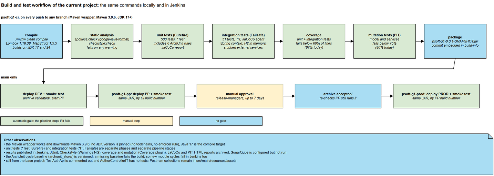
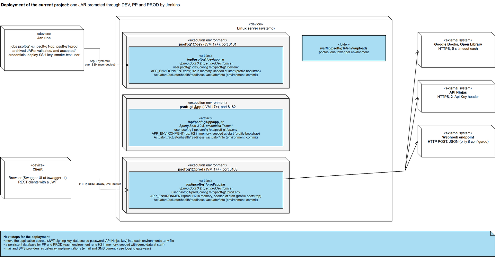

# Target development and deployment process

This document designs the development and deployment process of the current project (the system-to-be)
and records the decisions behind it. It starts from the problems found in the
[base project report](../system-as-is/base-project-state.md). The process it describes is the one now
implemented in `jenkins/` and `deploy/`, and measured in the
[current project report](../system-current/current-project-state.md). The
[CI/CD evaluation](../cicd-evaluation.md) compares the two processes with metrics.

## 1. Starting point

The base project had no development process beyond each developer's machine:

| ID | Problem in the base project |
|---|---|
| P1 | No CI: a push triggered nothing; building, testing and running were manual. |
| P2 | The Maven wrapper was broken and the build failed on current JDKs. |
| P3 | No static analysis or formatting: 5,682 Checkstyle warnings. |
| P4 | Unit and integration tests mixed in one phase; 102 tests, 19.9% line coverage, 30% mutation score. |
| P5 | No coverage, mutation or architecture checks; nothing stopped quality or structure from eroding. |
| P6 | No deployable artifact management: the JAR was built locally and never versioned or archived. |
| P7 | No environments: one implicit environment, the developer's machine. |
| P8 | No health endpoint and no way to know which build is running where. |
| P9 | One configuration file for every purpose; secrets committed. |

## 2. Requirements for the target process

- **R1.** Every push is built, analysed and tested automatically, at several test levels.
- **R2.** Quality is measured (static analysis, coverage, mutation) and enforced by gates.
- **R3.** Build, quality and test results are reported where the team looks: the CI server.
- **R4.** One deployable artifact per change, traceable to its commit, created once and managed.
- **R5.** Deployment to development, staging (pre-production) and production is configurable and
  repeatable.
- **R6.** Each deployment is verified, and production needs an explicit acceptance.
- **R7.** The process is measurable, so it can be compared with the base project's and improved.

Constraints:
- **C1.** One Linux server is available for all environments.
- **C2.** The course's reference delivery model uses Jenkins, with the application run as a JAR by systemd
  and reached over SSH.
- **C3.** The application stays a Spring Boot modular monolith (see the [ADD record](../../architecture/add.md)).

## 3. Target process

1. **Commit stage (`psoft-g1-ci`, every branch).** The stages run in order, and each one stops the
   pipeline if it fails:
   1. compile;
   2. formatting and Checkstyle;
   3. unit tests, including the architecture rules;
   4. integration tests;
   5. the coverage gate;
   6. mutation testing with its gate;
   7. package the JAR with the commit embedded.

   The test, Checkstyle, coverage and mutation reports are published in Jenkins.
2. **DEV (on `main` only).** The JAR is deployed to DEV and smoke-tested, then archived as *validated*.
   PP starts with that build number.
3. **PP / staging (`psoft-g1-pp`).** The same JAR is deployed and smoke-tested. A release manager accepts
   it, and Jenkins checks that PP still runs it. It is then archived as *accepted*, and PROD starts.
4. **PROD (`psoft-g1-prod`).** The accepted JAR is deployed and smoke-tested, and the full record is
   archived.

## 4. Decisions

| ID | Decision | Alternatives considered | Rationale | Solves |
|---|---|---|---|---|
| DP-1 | Jenkins, with the pipelines as code in the repository (`jenkins/Jenkinsfile.*`) | GitHub Actions; pipelines configured in the Jenkins UI | C2 prescribes Jenkins. Pipelines in the repository are versioned and reviewed with the code, and run the same way on every agent. | P1, R1 |
| DP-2 | Three pipelines (CI, PP, PROD), chained by build number | One pipeline with every stage; a Multibranch pipeline | Each stage of delivery has its own history, trigger, approval and permissions. A failed production deployment can be re-run without rebuilding. Multibranch job names would break the copy between jobs. | R4, R5 |
| DP-3 | Build once, promote the same JAR (archived and copied by build number, fingerprinted) | Rebuild for each environment; publish to an artifact repository | Promoting one binary guarantees that PROD runs exactly what PP accepted. Jenkins archives with Copy Artifact cover the need without another server (C1). | P6, R4 |
| DP-4 | The commit embedded in the JAR (`build-info`) and exposed by `/actuator/info` with the environment name | Version numbers only | Each environment can say which commit it runs; the smoke test compares it with the expected one. | P8, R4 |
| DP-5 | A working Maven wrapper and Lombok/Byte Buddy versions that build on current JDKs | A Maven installation on each agent | The same command (`./mvnw …`) builds the project on every machine and in CI. | P2 |
| DP-6 | Spotless (google-java-format) and Checkstyle with zero tolerance as a CI stage | Reports without a gate; SonarQube as the gate | The code was reformatted once (5,682 warnings to 0), so a zero-warning gate keeps it clean at no cost. SonarQube is configured for on-demand analysis against a SonarQube server. | P3, R2 |
| DP-7 | Unit tests (`*Test`, Surefire) and integration tests (`*IT`, Failsafe) as separate stages | One test phase | Fast feedback first; Spring-context tests only after the unit tests pass. The test strategy is in [`testing-strategy.md`](../../testing/testing-strategy.md). | P4, R1 |
| DP-8 | Architecture rules as unit tests (ArchUnit), with the module cycles frozen in a versioned baseline | Code review only | The rules run on every build. The existing cycles cannot all be removed (see the ADD record), so they are frozen and only new ones fail. A missing baseline fails the build. | P5, R2 |
| DP-9 | Coverage measured over unit and integration tests together, with a line-coverage gate (JaCoCo) | Coverage of unit tests only; no gate | Integration and system tests cover the REST layer and the wiring; counting them gives the real coverage. The gate stops coverage from silently dropping. | P5, R2 |
| DP-10 | Mutation testing (PIT) on `model` and `services`, failing below 75% | Coverage only | Coverage says what runs, not what is checked. Mutation testing measures whether the tests detect faults. | P5, R2 |
| DP-11 | Results published in Jenkins: JUnit, Checkstyle (Warnings NG), coverage and mutation (Coverage plugin), HTML reports archived | Reports only in the build log | The team sees trends and failures per build without reading logs. | R3 |
| DP-12 | One server with three systemd services (`psoft-g1@dev/pp/prod`), each with its own user, folders and `.env` file; set up by a script | Docker images and compose (tried in `9fb8849`, replaced in `d269fd8`); one server per environment | C1 and C2. Separate users, directories and ports isolate the environments, and the hardened unit limits each one. The setup script makes the environments repeatable. | P7, R5 |
| DP-13 | Deployment by script over SSH: copy, stop, swap, start; locked per environment | Manual copies; a configuration-management tool | The script is the same for every environment. A lock prevents two deployments to one environment at once. The `deploy` account can only start and stop those services. | R5 |
| DP-14 | A smoke test after every deployment: build and environment identity, readiness, login, an authenticated call, a rejected anonymous call | Trust the CI tests | The CI tests do not prove that the deployed configuration starts and serves requests. | P8, R6 |
| DP-15 | Manual acceptance in PP before PROD (`release-managers`), with a re-check that PP still runs that JAR | Automatic promotion to PROD | Production changes need an explicit decision; the re-check prevents accepting a JAR that is no longer the one deployed. | R6 |
| DP-16 | Environment configuration outside the JAR (`/etc/psoft-g1/<env>.env`); feature settings in properties, validated at startup | One properties file per environment inside the JAR | Changing a setting needs no rebuild; a wrong value fails at startup, which the smoke test catches. | P9, R5 |
| DP-17 | Rollback by re-running PROD with an earlier PP build | Automatic rollback on a failed smoke test | Simple and explicit with the archived JARs. Automatic rollback is a candidate improvement. | R5 |

## 5. Known limitations of the design

- **The application's secrets are still in the repository.** The JWT key, the database password and the
  API key are in `src/main/resources`, outside DP-16's scope. Jenkins keeps only the deployment
  credentials.
- **In-memory database.** Each environment runs H2 in memory, reseeded with demo data on every start.
- **All environments share one server (C1).** A fault in the server affects them all.
- **Rollback is manual (DP-17),** and limited to the 30 builds Jenkins keeps.
- **The process metrics need a running Jenkins to collect:** deployment frequency, lead time, change
  failure rate and recovery time. The [CI/CD evaluation](../cicd-evaluation.md) explains how.
